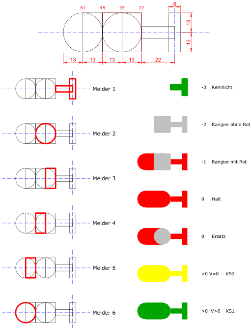

# Signale – fachliche Arten und Geschwindigkeiten

Dieses Dokument beschreibt die verbindlichen fachlichen Vorgaben für **Signale** in `estw3`. Die hier festgelegten Signalarten und Geschwindigkeitswerte gelten für die allgemeine Fahrstraßenlogik sowie für Rangier- und Zugstraßen.

## Signalarten nach Unterelementart

Ein Element vom Typ **Signal** (`ElementTypId = 3`) wird durch seine `UnterElementArt` fachlich weiter unterschieden:

|Unterelementart|Fachliche Bedeutung|
|-|-|
|1|Hauptsignal als Mehrabschnittssignal mit integriertem Rangiersignal|
|2|Rangiersignal|

## Zustandslogik

Ein Signal besitzt in seiner Zustandslogik zwei Geschwindigkeitswerte:

- die **Hauptsignalgeschwindigkeit (HSV)** und
- die **Vorsignalgeschwindigkeit (VSV)**.

### Hauptsignalgeschwindigkeit

Die Hauptsignalgeschwindigkeit eines Signals gibt an, ob und mit welcher Geschwindigkeit ein Zug das Signal passieren darf. Sie ist ein ganzzahliger Wert im Bereich von `-3` bis `16`.

Für **Zugstrassen und Rangierstrassen** gilt gleichermaßen: Ausschließlich die Hauptsignalgeschwindigkeit `0` ist ein **Haltbegriff** beziehungsweise eine **Haltstellung**. Die Werte `-1` und `-2` bezeichnen Rangierfahrt und sind auch bei der Prüfung einer Zugstrasse keine Haltbegriffe.

Für **Zugstrassen** gilt:

- Die Hauptsignalgeschwindigkeit `0` ist die **Haltstellung**.
- Eine Hauptsignalgeschwindigkeit größer `0` ist eine **Fahrtstellung**. Der Wert multipliziert mit `10` ergibt die maximal zulässige Geschwindigkeit in km/h.

Für **Rangierstrassen** gilt:

- Die Hauptsignalgeschwindigkeit `0` ist die **Haltstellung**.
- Die Hauptsignalgeschwindigkeiten `-1` und `-2` sind **Fahrtstellungen**.
- Hauptsignalgeschwindigkeiten größer `0` sind für Rangierstrassen ungültig und dürfen nicht als **Haltstellung** gewertet werden.

Die Hauptsignalgeschwindigkeit `-3` bedeutet **Kennlicht**. Das Signal hat in dieser Stellung sowohl für eine Zugstrasse als auch für eine Rangierstrasse keine Bedeutung; der Lokführer darf es ignorieren. **Kennlicht ist kein Haltbegriff** und erfüllt keine geforderte Haltstellung oder Haltbestätigung.

Wird in der Fahrstrassenlogik eine Haltstellung angefordert, ist damit die Anforderung von `HSV = 0` gemeint. Eine tatsächlich erreichte Haltstellung ist ausschließlich bei `HSV == 0` bestätigt. Dies gilt insbesondere für die Zulassungsprüfung, den Signalflankenschutz, die Reaktion auf weggefallene Überwachungsvoraussetzungen und die Fahrstrassenauflösung. Die projektierte `SollStellung` allein ist kein Nachweis des tatsächlich erreichten Signalzustands.

|Wert|Bedeutung|
|-|-|
|-3|Kennlicht: Signal für Zug- und Rangierstrassen ohne Bedeutung; kein Haltbegriff|
|-2|Fahrtstellung für Rangierstrassen (ohne Rot)|
|-1|Fahrtstellung für Rangierstrassen (mit Rot)|
|0|Halt|
|1|Fahrt mit maximal 10 km/h|
|2|Fahrt mit maximal 20 km/h|
|3|Fahrt mit maximal 30 km/h|
|4|Fahrt mit maximal 40 km/h|
|5|Fahrt mit maximal 50 km/h|
|6|Fahrt mit maximal 60 km/h|
|7|Fahrt mit maximal 70 km/h|
|8|Fahrt mit maximal 80 km/h|
|9|Fahrt mit maximal 90 km/h|
|10|Fahrt mit maximal 100 km/h|
|11|Fahrt mit maximal 110 km/h|
|12|Fahrt mit maximal 120 km/h|
|13|Fahrt mit maximal 130 km/h|
|14|Fahrt mit maximal 140 km/h|
|15|Fahrt mit maximal 150 km/h|
|16|Fahrt mit maximal 160 km/h|

### Vorsignalgeschwindigkeit

Die Vorsignalgeschwindigkeit eines Signals ist nur für **Zugstrassen** relevant. Sie gibt an, mit welcher Geschwindigkeit der Zug das im Fahrweg vorausliegende Hauptsignal passieren darf. Die Vorsignalgeschwindigkeit ist ein ganzzahliger Wert im Bereich von `0` bis `16`.

In der Fahrstraßenlogik wird die Vorsignalgeschwindigkeit aus der Hauptsignalgeschwindigkeit des Elements ermittelt, das in der Zugstrasse als **Vorwegelement** projektiert ist. Ist kein Vorwegelement projektiert, wird das **Zielelement** zur Ermittlung der Vorsignalgeschwindigkeit verwendet.

Für das Signalsystem **KS** gilt:

|VSV|Signalbegriff|
|-|-|
|0|KS2|
|> 0|KS1|

## Bildschirmdarstellung

